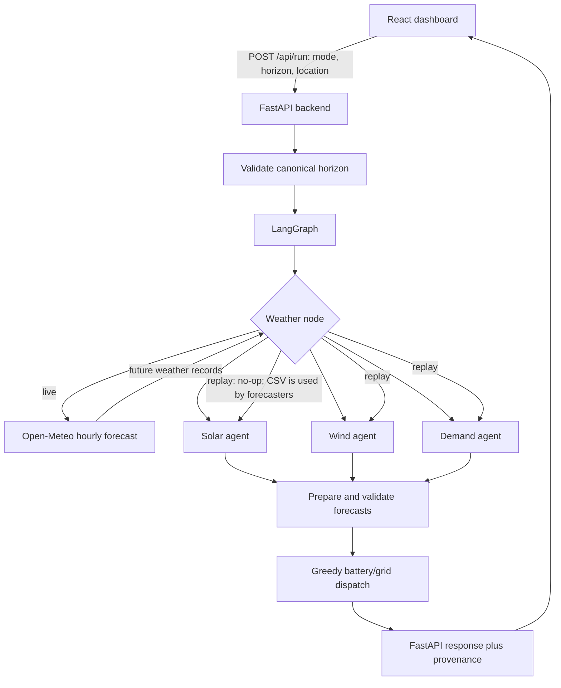
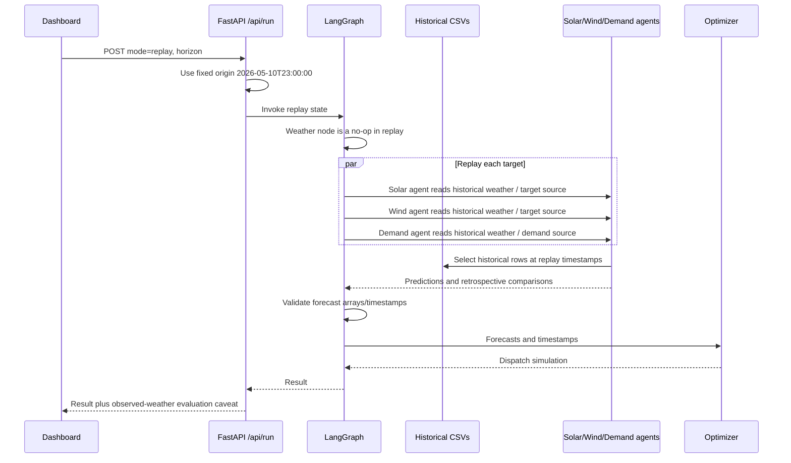

# Forensic Audit: Gujarat Renewable-Energy Forecasting and Optimization System

**Audit date:** 2026-10-11  
**Scope:** Read-only source, dataset, artifact, report, and targeted-test inspection. This document is a new audit artifact; no source code, source datasets, model artifacts, or existing reports were changed for the audit.

## 1. Executive summary

The primary dashboard calls a real, connected LangGraph workflow: a live weather fetch is followed by solar, wind, and demand models, alignment checks, and battery/grid dispatch. The deployed primary forecasting path is not Chronos. It uses local scikit-learn `HistGradientBoostingRegressor` artifacts and Open-Meteo hourly weather for live requests. Historical replay uses static CSVs and the same pointwise weather-to-output models.

There is no evidence in the inspected primary path that a current live forecast is silently replaced with an old saved prediction or random profile. Live weather records are passed to the forecasters, and weather retrieval/coverage errors are returned as errors. That supports the claim that the live path attempts a new provider-backed forecast; it does **not** establish that the target datasets are authentic, the weather forecast is accurate, or the energy predictions are operationally validated.

The most important scientific limitation is target provenance. The target columns are named `*_hourly_est`; the solar/wind source tag `true_CEA` is present, but its lineage could not be verified from repository evidence. Demand is also an estimated-named target. The project has no in-repository raw-data derivation pipeline that traces those series to independently verifiable metered or official records. Consequently, the saved test scores establish performance against the included dataset labels under observed future weather—not against verified metered production/demand and not against operational live forecasts.

Saved chronological held-out scores are promising for solar and weaker for wind/demand. The 80% nominal q10-q90 intervals have poor held-out coverage for wind (about 65%) and demand (about 35%). Those intervals should not be represented as reliable uncertainty bounds. The score report was inspected but not regenerated in this audit.

The optimizer is a deterministic greedy dispatch simulation, not a solver. It omits battery efficiency, degradation, explicit terminal state constraints, export/tariff economics, and a calibrated grid-stability definition. It can demonstrate simple energy balancing but is not evidence of production-grade grid optimization.

**Overall:** the project is a connected software demonstration with a meaningful historical weather-to-energy experiment and an operational-weather API path. It is not yet supported as a validated operational forecasting system or production-ready energy-management system. Data lineage, out-of-sample operational evaluation, interval calibration, model-artifact reproducibility, and optimizer assumptions need to be addressed before stronger academic or deployment claims.

## 2. Actual system architecture



The graph registers `weather`, `solar`, `wind`, `demand`, `prepare_forecasts`, and `optimization`; on a successful weather step it fans out to the three forecasters, joins them at preparation, and only dispatches after successful preparation (`orchestration/graph.py:14-59`). The nodes are in `orchestration/nodes.py`: weather acquisition at lines 38-90; agent calls around lines 93-213; response extraction/preparation around lines 215-343; optimizer invocation around lines 346 onward. `prepare_forecasts` rejects empty arrays or mismatched lengths; it extracts solar `forecast_mu`, wind `predicted`, and demand `forecast` values.

The dashboard's main request is `/api/run` (`frontend/src/App.jsx:45-70`; `backend/main.py:236-286`). The separate `/api/live/solar` route is a legacy solar-only path (`backend/main.py:172-233`) and is not the main dashboard request. `backend/main.py:236-286` constructs the workflow state, selects live versus replay, invokes the graph, and attaches provenance.

### Live execution sequence

```mermaid
sequenceDiagram
    participant U as Dashboard
    participant A as FastAPI /api/run
    participant G as LangGraph
    participant W as Weather Agent
    participant M as Open-Meteo
    participant F as Solar/Wind/Demand agents
    participant O as Optimizer
    U->>A: POST mode=live, horizon, location
    A->>A: Validate horizon; issue time in Asia/Kolkata
    A->>G: Invoke state with current forecast origin
    G->>W: Fetch forecast beginning at next hour
    W->>M: Request hourly weather variables and horizon
    M-->>W: Hourly forecast records
    W-->>G: Validate and return weather records
    par Forecast each target
        G->>F: Solar prediction using weather records
        G->>F: Wind prediction using weather records
        G->>F: Demand prediction using weather records
    end
    F-->>G: Point forecasts and intervals/metadata
    G->>G: Align timestamps and lengths
    G->>O: Solar, wind, demand, timestamps
    O-->>G: Dispatch schedule and summary
    G-->>A: Workflow result
    A-->>U: Result plus issue time, inputs, model metadata, evaluation caveat
```

The live weather node requires a timezone-aware origin, starts at the next whole hour, and returns an error if weather-agent retrieval fails (`orchestration/nodes.py:38-90`). The weather adapter supports horizons `{1, 24, 168, 360}` and requests up to 384 forecast hours (`agents/weather/forecast.py:30, 126, 350-445`). This covers the supported 15-day request length, subject to provider availability and validated response coverage.

### Replay/backtest execution sequence



This is a fixed-origin historical replay, not a general rolling-origin backtest. The replay origin is hardcoded to `2026-05-10T23:00:00` in `backend/main.py:251-255`. The weather node intentionally does nothing for replay; historical weather is read within the forecasting service.

## 3. Agent-by-agent analysis

| Agent/component | Implemented and invoked by primary API? | Actual role and inputs | Algorithm/output | Validation and downstream use | Main limitation |
|---|---|---|---|---|---|
| Weather | Yes for live; replay is a no-op | Acquires future hourly weather from Open-Meteo for the configured coordinates; replay weather comes from historical CSV input downstream | Data acquisition, variable mapping, wind-height resolution, clear-sky fallback; returns records and metadata | Validates supported horizon, required variables/coverage/shape; live records feed all three agents | Historical training weather and live provider differ in source and spatial representation |
| Solar | Yes | Weather-only mode receives the live future-weather records or historical CSV rows; target is `Gujarat_Solar_MU_hourly_est` | Local point, q10, q90 `HistGradientBoostingRegressor` models; output includes MU predictions and interval information | `prepare_forecasts` requires nonempty output, takes `forecast_mu`, and checks lengths | Target provenance is unverified; model test used observed future weather |
| Wind | Yes | Weather-only mode receives future weather or historical CSV rows; target is `Gujarat_Wind_MU_hourly_est` | Local point, q10, q90 gradient-boosted regressors | Preparation reads `predicted`; array lengths checked | Source tag lineage unverified; test interval coverage under nominal |
| Demand | Yes | Receives weather and calendar features; target is `Energy_Met_MU_hourly_est` from separate demand CSV | Local point, q10, q90 gradient-boosted regressors | Preparation reads `forecast`; array lengths checked | Dataset explicitly estimated-named; original source/definition not traced |
| Optimization | Yes after successful preparation | Consumes all three forecasts and timestamps | Greedy battery dispatch and arithmetic summary metrics | Rejects missing, non-finite, negative, or misaligned arrays | Heuristic simulation, not constrained mathematical optimization |

The main graph explicitly forces `config.engine = "weather_only"` for solar, wind, and demand (`orchestration/nodes.py:93-213`). It does not rely on Chronos in that execution path. The legacy agent code separately references `amazon/chronos-2`/`Chronos2Pipeline.from_pretrained`; those paths are not the primary graph's configured engine. The repository reference alone does not prove Chronos weights are present, downloaded, or successfully loaded in this environment.

Parallel branches write distinct result keys, which is the expected successful-path behavior. However, the state type has no reducers for shared `status`/`errors` fields; simultaneous branch failures could contend while writing those common keys. This is a plausible concurrency/error-reporting risk, not a failure reproduced in this audit.

## 4. Forecasting algorithm analysis

### Primary deployed models

`common/weather_only/models.py` defines the primary weather-only modeling implementation. It uses scikit-learn `HistGradientBoostingRegressor` (line 34, instantiated around lines 154-159), with three models per target: point estimate plus 0.1 and 0.9 quantile regressors. Predictions are formed for each target hour from that hour's weather and calendar features; the requested horizon is implemented by applying the same model to each future weather row. It is not an autoregressive or target-lag model.

Training loads the weather-generation CSV and demand CSV, masks `-999` sentinels, joins demand by timestamp, excludes rows with invalid required weather, and excludes solar/wind rows whose `generation_source` is not `true_CEA` (`models.py:75-109`). It sorts usable rows chronologically and creates a 70% training, 15% validation, 15% test split by row index after filtering (`models.py:223-275`). Validation MAE selects among three hyperparameter configurations; validation also calibrates interval widening. The test block is scored afterward. A month-by-hour climatology trained on the training block is included as a baseline. Deployment artifacts are subsequently refit on all valid rows (`models.py:277-300`).

The models use a linear level/trend adjustment with month effects, with extrapolation limited to 120 days beyond the model's training end (`models.py:130-151`, `MAX_EXTRAPOLATION_DAYS` at line 62). Solar predictions are clipped nonnegative and set to zero at night using irradiance features (`models.py:166-177`). Inference validates weather columns and rejects sentinel/missing/non-finite inputs (`models.py:340 onward`).

The saved solar artifact reports a training cutoff of 2026-05-30, so at the audit date (2026-10-11) it is beyond the 120-day trend extrapolation limit; its level-growth adjustment is frozen at the cap. Wind and demand artifacts report training through 2026-07-31 and are still within the limit at that date. This does not prove the solar model is unusable, but its age and trend behavior should be surfaced and monitored.

The implementation has a reproducibility side effect: `_load_artifact` retrains if a model file is missing or fails to load (`models.py:314-327`). The retraining writes a model file; `train_all` also writes `reports/weather_only/metrics.json` (`models.py:223-227, 303-311`). A request can therefore trigger writes if artifacts are absent or incompatible. Artifact loading/retraining was not exercised in this audit.

### Legacy Chronos references

Separate legacy solar/wind/demand paths reference Chronos-2. They are not selected in the primary graph because the graph explicitly chooses `weather_only`. This audit did not verify availability of model weights or successfully run those legacy paths; claims that the dashboard's main forecasts are Chronos-based would be incorrect.

### Features and timing

Weather-only feature construction uses same-hour weather and calendar information (`common/weather_only/features.py`). No target lags are used by the main weather-only forecasters, reducing one common source of leakage. However, test weather is the observed weather record at each target timestamp. This is a conditional mapping evaluation, not a simulation of what a forecaster would have known about future weather at the forecast origin. For live mode, weather covariates are provider forecasts. Accuracy of the operational chain therefore includes weather-provider error that the saved target-model test metrics do not include.

### Horizons

The canonical supported horizons are 1, 24, 168, and 360 hours (1 hour, 1 day, 7 days, 15 days). The API validates horizon names and hour counts (`backend/main.py:42-45, 236-240`). In the primary weather-only model, these are batches of per-hour predictions over future covariates, not a recursive target forecast. Live output length still depends on the provider returning the requested hourly weather records; the adapter checks coverage and fails rather than intentionally filling gaps with target forecasts. Replay uses the historical rows available at the hardcoded origin and horizon.

## 5. Data provenance and authenticity

The raw dataset audit found three directly referenced static CSVs. The files contain 18,264 hourly records spanning `2024-07-01 00:00:00` through `2026-07-31 23:00:00`. The weather-generation data has 16 columns; the demand data has 15 columns. `data/weather/raw/dataset.csv` and the weather-generation CSV have matching timestamps/schema/coverage according to the read-only comparison.

| Column / input | Repository-indicated source | Units / transformations | Observed status | Verification |
|---|---|---|---|---|
| `ALLSKY_SFC_SW_DWN`, `CLRSKY_SFC_SW_DWN` | Project docs identify historical weather as NASA POWER; live weather is Open-Meteo (`docs/WEATHER_ONLY_MODE.md:5-18, 97-100`) | Weather variables; `-999` converted to missing | 1,488 sentinel values in each irradiance column; sentinel interval is documented as a long tail block | Intended provider is documented; original download metadata/request payload not found in an in-repository derivation script |
| Other historical weather fields (`T2M`, `RH2M`, `WS10M`, `WS50M`, `PS`, `PRECTOTCORR`, `WD10M`, `WD50M`) | NASA POWER according to docs | Weather covariates | Present hourly in the CSV | Repository documentation, but exact raw retrieval lineage not independently established |
| Live hourly weather | Open-Meteo (`agents/weather/forecast.py:348-445`) | Provider forecast, mapped to model feature names; nearest valid paired wind height around 50m; clear-sky fallback can use Haurwitz | Retrieved for live requests; records and source metadata returned | Code path verified; no external live request was made for this audit |
| `Gujarat_Solar_MU_hourly_est` | CSV target; `generation_source` tag marks some rows `true_CEA` | MU/hourly target as named; rows not marked `true_CEA` are excluded for model training | 16,896 `true_CEA` rows and 1,368 `month_median_fill` rows | `true_CEA` label is not proof of upstream CEA provenance; no creator script or raw official source found |
| `Gujarat_Wind_MU_hourly_est` | CSV target; same source-tag field | MU/hourly target as named | Same source labels as solar | Exact derivation and metered/official lineage unverified |
| `Energy_Met_MU_hourly_est` | `data/demand/raw/gujarat_hourly_demand_estimated.csv` | Estimated-named target; auxiliary calendar and `Maximum_Demand_MW` fields also present | 18,264 hourly rows | Exact source, whether it represents state demand/consumption, and estimation formula unverified |
| `Gujarat_Solar_MU_daily_total`, `Gujarat_Wind_MU_daily_total` | Same weather-generation CSV | Daily totals | Present in raw schema | No in-repository derivation pipeline found; not used as weather-only model targets |
| `Maximum_Demand_MW` and calendar fields | Demand CSV | MW for maximum-demand-named field; derived calendar features | Present with hourly demand target | Original source and whether this field is independent/official were not verified |

The raw CSVs had zero literal NA values on read, but that must not be confused with fully observed data: sentinel irradiance values are encoded as `-999`. Model preprocessing masks them. The project docs also state that imputed generation rows exist and are excluded from model training. No in-repository script was found that creates the raw CSVs from NASA POWER, Open-Meteo, or CEA inputs. The intended providers and labels are documented, but lineage to original downloads/publications is incomplete.

### Data provenance conclusion

No conclusion that the datasets are synthetic or fraudulent is supported. Conversely, the available evidence does not establish that the target columns are independent metered measurements or official records. `true_CEA` is a source label that the code trusts, not a provenance verification. Academic materials should describe these as target series labelled/estimated as in the CSV and disclose that primary-source lineage remains unverified.

## 6. Synthetic, hardcoded, or misleading data

| Item | Assessment | Evidence and interpretation |
|---|---|---|
| Random/demo forecast in primary live graph | Not detected in inspected main path | Live predictions use Open-Meteo future-weather records and local model artifacts. No random generation fallback was identified in this path. |
| Silent weather fallback to historical weather during live failure | Not detected in inspected main path | Weather node reports failure and ends the graph; weather adapter validates coverage. This avoids intentionally passing stale CSV weather as live weather. |
| Historical replay origin | Confirmed hardcoded behavior | `/api/run` uses `2026-05-10T23:00:00` for replay (`backend/main.py:251-255`). This is a fixed experiment origin, not a user-selectable backtest window. |
| Imputed generation rows | Confirmed in dataset | 1,368 rows labelled `month_median_fill`. Model training excludes them for solar/wind (`models.py:102-109`). This is explicit imputation, not evidence of fraud. |
| Historical generation/demand target authenticity | Unverified | Column names and source labels are insufficient to confirm metered or official source. No raw lineage script/source metadata found. |
| Saved generated forecast reports | Possible stale artifacts; not evidence of live reuse | Existing report files may predate a run. The live API's code path does not read those forecast files as the current predictions. |
| API-key-shaped string in `.env.example` | Sensitive-looking value present; validity unknown | Do not reproduce it. Its status and whether it is usable are unverified. If genuine, treat as exposed: revoke/rotate it and replace the template value. Git tracking cannot be established because this workspace has no detected Git repository. |

## 7. Leakage and statistical validity

No target-lag or saved-prediction feature was found in the primary weather-only feature design. The main model maps same-hour weather/calendar features to same-hour target values. The chronological split is performed after filtering, and the validation block is used for model selection/calibration while the test block is scored separately.

The central methodological limitation is **future observed weather in test evaluation**. Test predictions are conditioned on recorded weather at each test timestamp, which is not available to an operational forecast at the initial issue time. This evaluates the energy model's mapping conditional on weather; it excludes Open-Meteo forecast error and end-to-end operational uncertainty. That distinction is explicitly documented in `docs/WEATHER_ONLY_MODE.md:64-70, 97-100` and reflected by provenance notes in `backend/main.py:126-164`.

The more fundamental unresolved risk is that the target data itself may be estimated/reconstructed. No derivation code was found, so target reconstruction from weather or another covariate cannot be ruled in or out. Correlations are plausible fingerprints, not proof of construction: solar target correlations with irradiance are about 0.50; wind target with WS50M about 0.84; demand with hour about 0.59. These are not suspiciously perfect by themselves and do not establish source authenticity.

The raw dataset has the following straightforward fingerprints (not model scores):

| Target | Raw statistics/correlations observed | Interpretation |
|---|---|---|
| Solar hourly target | Mean 3.568, std 4.809, max 24.622 MU; irradiance correlations approximately 0.501/0.502, temperature 0.536, humidity -0.513 | Weather relationships are plausible, but no independent source or formula validation follows from correlation. |
| Wind hourly target | Mean 3.621, std 2.676, max 15.27 MU; WS10M correlation 0.770, WS50M 0.837 | Plausible weather dependence; target lineage remains unverified. |
| Demand hourly target | Hour correlation 0.591, `Maximum_Demand_MW` 0.526, month -0.179, day-of-week -0.026 | Some daily structure is present; variable definition/source and independence of auxiliary maximum demand are unresolved. |

These statistics do not indicate outright fabrication. The audit did not find evidence sufficient to attribute the targets to an exact formula or to establish independent measurement.

## 8. Model performance and reproducibility

`reports/weather_only/metrics.json` contains saved observed-weather test results. Values below are rounded from that saved report, not freshly recomputed in this audit:

| Target | Test R² | Test MAE (MU) | Test RMSE (MU) | q10-q90 coverage, nominal 80% | Evidence assessment |
|---|---:|---:|---:|---:|---|
| Solar | 0.957 | 0.810 | 1.579 | 85.7% | Strong fit to included test labels under observed weather; does not validate live-provider end-to-end accuracy or target authenticity. |
| Wind | 0.608 | 1.398 | 1.811 | 65.3% | Moderate point performance; interval undercoverage is material. |
| Demand | 0.574 | 1.953 | 2.430 | 35.0% | Moderate point performance; severe interval undercoverage versus nominal 80%. |

The report also contains a month-by-hour climatology baseline. The test scores are described as chronological 70/15/15, with 70% train / 15% validation / 15% test; training implementation confirms that split and baseline approach (`common/weather_only/models.py:223-275`). Values are measured in the dataset's MU target scale. Actual deployment artifacts are refit on all valid rows after the split-based evaluation, so the deployed model artifact itself is not the test-only model. That is normal if clearly distinguished, but independent test scores must remain associated with the exact code/data/artifact version.

Reproduction is not established by this audit: saved metrics and artifact metadata were inspected, but no clean retraining/evaluation was performed because it writes model files and `reports/weather_only/metrics.json`. A fixed report path is used by `train_all`; an absent or incompatible artifact may also trigger training at inference (`models.py:303-327`). Training data versions/checksums, exact package lock state, and independently archived predictions are insufficient to establish bit-for-bit reproduction.

The saved metrics support a historical observed-weather experiment. They do not support a claim such as “live predictions are X% accurate.” The UI's `100 − WAPE` score is a scale-relative transformation, not a standard accuracy percentage; WAPE can exceed 100%, making that value negative. It should be named and explained as a derived score, not literal forecast accuracy.

## 9. Optimization and physical validity

`agents/optimization/optimizer.py` implements greedy dispatch, not linear/mixed-integer programming or a general optimizer. Each hourly step computes renewable surplus/deficit. On deficit, it discharges at most the available state of charge, configured discharge limit, and deficit; on surplus, it charges at most battery headroom, charge limit, and surplus. Remaining deficit becomes grid import; remaining surplus is curtailed (`optimizer.py:51-101`).

```text
renewable[t] = solar[t] + wind[t]
net_load[t] = demand[t] - renewable[t]

if net_load[t] > 0:
    discharge[t] = min(SOC[t], discharge_limit, net_load[t])
    grid_import[t] = net_load[t] - discharge[t]
else:
    charge[t] = min(capacity - SOC[t], charge_limit, -net_load[t])
    curtailment[t] = -net_load[t] - charge[t]
```

The model begins at a fixed 50% state of charge with default capacity 1 MU and charge/discharge limits 0.2 MU per step. It does not model round-trip efficiency, battery degradation, ramp/response limits in MW, terminal SOC, reserve requirements, tariffs, export, or market dispatch. No terminal condition means energy can be depleted at the end of the horizon with no penalty. The code's “Grid Stability Index” is a bounded heuristic based on peak deficit ratio and average net-load ramp, weighted 40/60 (`optimizer.py:120-139`); it is not a standard grid stability measure or demonstrated power-system stability calculation.

The unit conversion and time-step assumptions need formal definition before physical interpretation. Inputs are hourly MU series and dispatch limits are treated per step. The code checks nonnegative finite values and length equality, but does not validate capacity against a real facility or enforce a physically calibrated power/energy mapping. This is useful as an educational dispatch illustration, not a validated grid optimizer.

## 10. Frontend and API audit

| Dashboard element | Backend source / calculation | Verified? | Risk |
|---|---|---|---|
| Mode and horizon controls | Dashboard posts to `/api/run`; horizons map to 1/24/168/360 hours (`App.jsx:21, 45-70, 160-180`; `backend/main.py:236-268`) | Yes, wired into request path | Replay is one hardcoded origin rather than a general backtest selector. |
| Solar/wind/demand forecast displays | Corresponding graph agent results and optimizer schedule | Yes, full graph is the dashboard path | Target provenance is not established; unit labels depend on target definition. |
| Run issued time / forecast origin / window | Backend provenance builder | Yes; includes issue time, horizon, weather source and model metadata | Replay origin fixed; metadata describes inputs but cannot prove upstream dataset authenticity. |
| Held-out test metrics | Artifact metadata passed through response | Yes, as historical model scores | They use observed future weather and do not represent current live run accuracy. |
| Replay WAPE / derived “accuracy” | Replay predictions compared with available historical targets in weather-only service (`service.py:140-204`) | Code path exists | WAPE-derived `100 − WAPE` is not conventional accuracy; target truth status remains uncertain. |
| Grid Stability Index | Optimizer heuristic | Value is calculated | Label may imply a validated power-system index when it is a custom score. |
| Live weather provenance | Weather-agent result and metadata | Code exposes provider/coordinates/record count and selected weather handling | No provider request was made during the audit; runtime availability is not verified here. |

The transparency changes are directionally good: the dashboard distinguishes live from replay and explains that live accuracy is unavailable until actual future outcomes exist (`frontend/src/App.jsx:268-364`). One remaining precision issue is to avoid describing a held-out observed-weather score as evidence of operational forecast accuracy. The backend provenance text says historical targets are “measured” in replay (`backend/main.py:148-164`), but the repository evidence does not establish that all target series are measured; the dataset uses estimated-named columns and the demand source is unresolved. That wording should be corrected in a future change after source verification.

## 11. Security and reliability

* **Credential exposure risk:** `.env.example` contains an API-key-shaped value. Its validity is unknown and the value is deliberately omitted from this report. If it is genuine, revoke/rotate it and replace it with a non-secret placeholder. Because there is no detected `.git` repository in the workspace, whether the value is tracked or historically exposed cannot be checked.
* **Artifact side effects:** missing/unreadable weather-only artifacts can cause automatic retraining and writes during inference. This can make API latency unpredictable and modify local model files/reports (`models.py:314-327`).
* **Parallel error state:** separate successful result keys are safe in normal operation; common `status` and `errors` writes lack reducers, so concurrent failures may collide. This is a risk needing explicit test/reducer design, not a reproduced defect.
* **Historical/live failure semantics:** live weather failure stops the workflow rather than intentionally substituting stale CSV weather, which is a positive integrity control.
* **Fixed replay origin:** current replay is not a configurable historical-origin experiment; users can mistake its results for a generic or latest replay unless the fixed origin is prominent.
* **Repository state:** the workspace was not detected as a Git repository, preventing verification of branch, diff, tracked status, or history. No destructive or source-changing audit operations were performed.

## 12. Findings register

| ID | Finding | Severity | Evidence | Scientific impact | Recommended action |
|---|---|---|---|---|---|
| F-01 | Historical target-data lineage is not established by repository evidence | High | Static CSVs; target columns `*_hourly_est`; no in-tree upstream generation pipeline found; `true_CEA` is a label, not source proof | Prevents claims of validated performance against independently verified generation/demand observations | Archive source publications/downloads, extraction scripts, definitions, units, timestamps, and checksums; distinguish measured from estimated |
| F-02 | Held-out model metrics use observed future weather | High | Training/test code evaluates weather at each test timestamp (`models.py:223-275`); docs disclose observed-weather experiment | Scores exclude operational weather forecast error and overstate evidence for a live pipeline if presented without caveat | Add forecast-vintage weather backtesting and evaluate the full weather-to-energy chain |
| F-03 | Wind/demand q10-q90 test intervals materially under-cover | High | Saved metrics: 65.3% wind and 35.0% demand coverage versus nominal 80% | Uncertainty bands are not reliable at stated nominal coverage | Recalibrate on independent rolling-origin data, report coverage by horizon/season and interval width |
| F-04 | Backend replay describes targets as measured despite uncertain source and estimated naming | High | `backend/main.py:148-164`; CSV targets are estimated-named and source lineage is incomplete | May overstate the ground-truth quality and credibility of replay score | Use neutral “dataset target values” wording until verified source establishes measurement status |
| F-05 | Replay endpoint uses a hardcoded historical origin | Medium | `backend/main.py:251-255` | Not a selectable-origin or comprehensive backtest; one period may not represent generalization | Make origin/window explicit and support rolling-origin evaluation with logged data availability |
| F-06 | `100 − WAPE` is presented as an accuracy-like percentage | Medium | `common/weather_only/service.py:165-179`; dashboard replay panel | Nonstandard interpretation; may be negative and is not probability/correctness percentage | Label as derived `100 − WAPE` or report WAPE directly with unit/definition |
| F-07 | “Grid Stability Index” is a custom heuristic, not validated stability metric | Medium | `optimizer.py:120-139` | Metric name may imply established power-system meaning | Rename/disclose formula or validate against an accepted stability measure |
| F-08 | Dispatch omits losses, terminal conditions, economics, and calibrated physical limits | Medium | `optimizer.py:34-48, 76-101, 168-174` | Schedule is a simplified simulation and may be physically/economically unrealistic | Define facility parameters and units; add efficiency, terminal/reserve constraints, export/tariff assumptions, and validation |
| F-09 | Missing/incompatible model artifacts can initiate implicit training and file writes | Medium | `models.py:314-327`; train/report writes at lines 223-227, 303-311 | Runtime behavior is non-reproducible/slow and may mutate artifacts during a request | Separate explicit training from inference; fail clearly when production artifacts are unavailable |
| F-10 | `.env.example` includes a secret-shaped API-key value of unknown validity | High if genuine; otherwise informational | File inspected; value withheld | A usable credential could be abused; history/tracking status unavailable | Revoke if valid; remove from template/history and use a clearly inert placeholder |
| F-11 | Parallel branch error updates share state without reducers | Low/Medium | `orchestration/state.py`; branches update `status`/`errors` | Concurrent failures may yield incomplete or conflicting diagnostics | Add deterministic aggregation and a test for simultaneous branch failures |
| F-12 | NASA POWER training weather and point-location Open-Meteo live weather differ | Medium | `docs/WEATHER_ONLY_MODE.md:97-100`; weather adapter metadata in `agents/weather/forecast.py:432-445` | Domain/source shift can degrade live inference beyond historic test scores | Validate on archived provider forecasts at matching locations/resolutions; report covariate shift |

## 13. Prioritized remediation plan

### Immediate corrections

1. Treat the secret-shaped `.env.example` content as compromised if real: revoke/rotate, replace with a non-functional placeholder, and inspect repository history once Git metadata is available.
2. Correct replay wording from “measured historical targets” to “historical dataset target values” until primary provenance is documented.
3. Label the saved metrics as **observed-weather held-out scores**, not live accuracy; label `100 − WAPE` as a derived score or show WAPE alone.
4. Display that nominal 80% wind/demand intervals under-covered on the saved test set.

### Required before academic evaluation

1. Recover original CEA/state-demand/NASA POWER source files or publications, document the exact target construction, and include scripts/checksums/license/access dates.
2. If hourly generation/demand is estimated or imputed, report it as estimated, document the estimator, and avoid presenting it as meter ground truth.
3. Run rolling-origin backtests. Use actual weather forecast vintages (or provider archived forecasts) for operational evaluation; separately retain observed-weather evaluation as a conditional model experiment.
4. Re-evaluate q10-q90 coverage over multiple time windows and horizons; report sample counts, MAE/RMSE, baseline comparison, interval coverage, and interval width.
5. Pin dependencies, capture model/data hashes and training configuration, save predictions with origin and input provenance, and make explicit training reproducible without overwriting existing evidence.
6. Document target units and the meaning of `Energy_Met_MU_hourly_est`, solar/wind hourly MU values, and any maximum-demand covariate.

### Required before deployment

1. Separate training from inference and validate artifact versions at startup; do not silently retrain inside a request.
2. Add monitoring for provider missing coverage, weather distribution shifts, stale model cutoffs, target error after realization, and interval calibration.
3. Define optimizer asset parameters, losses, terminal SOC/reserve, import/export limits, and price/objective. Validate energy-balance equations and units with engineering test cases.
4. Define robust deterministic aggregation of parallel errors and test partial-result behavior.
5. Make replay origin and historical window explicit in the API/UI; prevent fixed demonstration origins from appearing as current live results.

### Optional improvements

* Compare against persistence and seasonal persistence in addition to the month-by-hour climatology baseline.
* Add diagnostics for duplicates, timestamp gaps, abrupt source transitions, target bounds, and repeated profiles to a provenance report.
* Add charts for observed-versus-predicted test windows and residuals, with provenance and evaluation mode adjacent to each chart.
* Evaluate calibration per season, daylight status, and forecast horizon.

Prerequisites: verified data definitions and a reproducible data pipeline must precede a strong accuracy claim; archived weather forecast vintages must precede operational weather-to-energy accuracy claims; optimizer physics/parameters must precede real dispatch recommendations.

## 14. Final scientific credibility assessment

| Dimension | Classification | Basis |
|---|---|---|
| Data provenance | Insufficient evidence | Intended providers are documented, but upstream source files/derivation scripts and complete target lineage are absent |
| Data authenticity | Partially supported | Static data and source labels exist; there is no evidence sufficient to call it fabricated, but independent authenticity is unverified |
| Target-variable validity | Insufficient evidence | Targets are estimated-named; exact definitions, units, and measured/estimated status are not established |
| Feature validity | Credible with documented limitations | Weather and calendar features are plausible; live/training weather sources differ |
| Model implementation correctness | Credible with documented limitations | Main models are actual local gradient-boosting regressors and validated inputs; artifact fallback can train implicitly |
| Training methodology | Credible with documented limitations | Chronological 70/15/15 split, validation selection, held-out test, climatology baseline; artifact/data provenance and clean reproducibility incomplete |
| Forecasting methodology | Partially supported | Direct per-hour weather-to-target predictions operate over multiple horizons; no operational multi-horizon validation with future weather vintages |
| Leakage prevention | Credible with documented limitations | No target lags in primary features; observed future weather is used in retrospective test scoring |
| Evaluation methodology | Partially supported | Saved scores describe observed-weather holdout, but are not freshly reproduced and do not establish full live accuracy |
| Baseline comparison | Credible with documented limitations | Month-by-hour climatology baseline exists; other baseline coverage and per-horizon comparisons are not established |
| Long-horizon validity | Insufficient evidence | 7-/15-day inference is per-hour application over provider covariates; no evidence of operational validation at these horizons |
| Optimization validity | Confirmed limitation | Greedy dispatch is implemented; physical/economic constraints and standard stability validation are absent |
| Operational reproducibility | Insufficient evidence | Artifact auto-training, no verified pinned environment/data hashes, and no audit-time clean retraining |
| Dashboard transparency | Credible with documented limitations | Live/replay and provenance are shown; measured-target replay wording and derived accuracy-like score need precision |
| Scientific claims versus evidence | Partially supported | The software and conditional historical experiment are demonstrable; operational accuracy and authentic targets are not yet established |

**Legitimate current claims:** the application connects a live weather acquisition route, local weather-conditioned solar/wind/demand prediction models, and a deterministic dispatch simulation; it also reports a historical observed-weather holdout experiment against the included dataset targets.

**Claims not established:** that the labels are verified official/metered ground truth; that live forecasts have the displayed historical score as accuracy; that wind/demand uncertainty bounds achieve nominal coverage; that the dispatch is a production grid optimizer; or that the complete system is deployment-ready.

The most accurate characterization is **an integrated forecasting software demonstration with a conditional historical forecasting experiment and simplified grid-dispatch simulation**. It is not yet a **validated operational renewable-energy forecasting system** or a **production-ready energy-management system**.

## 15. Reproducibility instructions and audit validation

### Safe commands used in this audit

Targeted tests were run without pytest's cache provider:

```powershell
python -m pytest -p no:cacheprovider tests/weather/test_weather_forecast.py tests/weather/test_live_solar_integration.py -q
```

**Result:** 42 passed in 2.11 seconds; 89 warnings, including NumPy timedelta deprecation warnings. No live external provider request was intentionally issued by this check.

A prior implementation session recorded 65 passing tests and successful frontend build/lint before this audit. Those were not rerun as part of this read-only audit. A full suite or graph-backed test may write reports depending on its test paths; inspect those paths or use a disposable copy before running.

### Dataset inspection

The raw CSVs were read-only inspected with pandas for schema, row count, timestamp coverage, missing/sentinel counts, source-label counts, and simple descriptive statistics/correlations. No data files were regenerated or modified. The dataset inspection method can be reproduced with a Python script that calls `pandas.read_csv` on:

```text
data/wind/raw/gujarat_hourly_weather_generation_final.csv
data/demand/raw/gujarat_hourly_demand_estimated.csv
data/weather/raw/dataset.csv
```

Ensure the script only prints to stdout and does not write normalized data or reports.

### Reproducing saved model metrics

The repository documentation points to:

```powershell
python scripts/train_weather_only.py
```

**Do not run this in the evidence directory without first copying the project/data/artifacts.** Training writes `models/weather_only/*.joblib` and `reports/weather_only/metrics.json`; inference may also retrain missing artifacts. Compare fresh results only in a disposable copy and record Python/package versions, source data hashes, model hashes, and resulting report hash. The metrics in this report are from the existing saved JSON and have not been regenerated here.

### Running the API

For manual functional reproduction, in a disposable copy:

```powershell
python -m uvicorn backend.main:app --host 127.0.0.1 --port 8000
```

Then send `POST /api/run` with a validated horizon and either `mode: "live"` or `mode: "replay"`. Live mode may make an external Open-Meteo request; replay is fixed to the origin described above. Both may cause writes if artifacts are missing or if agent output saving is enabled. Do not treat an API response as an independent validation result.

### Repository validation limitations

The workspace was not detected as a Git repository, so the audit could not verify branch state, working-tree diffs, commit history, file tracking, or whether generated reports are versioned. External weather-provider availability, Chronos model downloads/weights, and clean artifact loading were not tested.

## 16. Unverified questions

| Unresolved question | Evidence needed |
|---|---|
| What is the original source and derivation of solar/wind hourly values tagged `true_CEA`? | Source publication/download, extraction script, source IDs, units, and a reconciliation against original records |
| What does demand target `Energy_Met_MU_hourly_est` represent: state demand, energy met, consumption, or a constructed estimate? | Dataset author/data dictionary, upstream source, and documented transformation to hourly MU |
| Are daily totals and hourly generation independently measured or mathematically allocated? | Original daily/hourly source records and derivation code |
| Were weather datasets downloaded directly from NASA POWER, and with which site/aggregation/API parameters? | Archived request parameters/metadata, data retrieval script, station/grid definitions, and download timestamps |
| Are the model artifacts available, compatible, and the ones used by an API run? | Artifact hashes, package versions, safe explicit load test, model metadata, and request/run ID logging |
| Do Open-Meteo live weather records cover all four horizons in the deployed environment? | Controlled provider request for each horizon or recorded provider-response fixtures; this audit did not call the external API |
| What is the real validity of the API-key-shaped value in `.env.example`? | Owner/provider verification and credential rotation; do not place the value in logs or reports |
| Do simultaneous parallel agent failures produce missing/conflicting diagnostics? | Deterministic graph test with two or more failing branches |
| Are live forecasts accurate after actual outcomes arrive? | Archived forecast vintages joined to subsequent verified generation/demand measurements, evaluated by issue time and horizon |
| Does dispatch satisfy site-specific physical and market constraints? | Site battery power/energy/efficiency specifications, grid interconnection constraints, tariffs, and independent engineering validation |

## Implementation addendum (2026-10-12)

After this audit snapshot, the historical evaluation path was changed:

* `POST /api/run` with `mode: "replay"` now calls the origin-aware service, accepts an optional `forecast_origin`, fits models only from eligible pre-origin rows, and keeps the existing response shape for the dashboard.
* Eligibility is bounded by observation timestamp. The CSVs have no publication/availability timestamps or archived vintages, so the actual historical availability of those values at a given origin remains unverified.
* Direct graph replay is rejected with an explanation rather than silently loading deployment artifacts. Live LangGraph inference remains unchanged.
* The standalone `scripts/backtest_weather_only.py` command evaluates an explicit modest set of origins/horizons and writes only to a new run directory under `reports/backtests/`. Each run records input-file SHA-256 checksums and library versions.
* A one-origin, 24-hour experiment was run on 2026-04-30 for the three targets. Its observed-weather results and predictions are in `reports/backtests/smoke_20261012_0016/`. These are conditional metrics against the included target values, not operational-weather accuracy or proof of target authenticity. No full 12-case, all-horizon experiment was run.

The existing deployment artifacts and `reports/weather_only/metrics.json` were not rewritten by that experiment. During regression testing, the graph's live test path did write the agent report files under `reports/solar/`, `reports/wind/`, `reports/demand/`, and `reports/optimization/`; those were not part of the backtest experiment. The graph now has a `save_agent_reports` control, and the live graph regression fixture disables report writes to avoid repeating this side effect.
